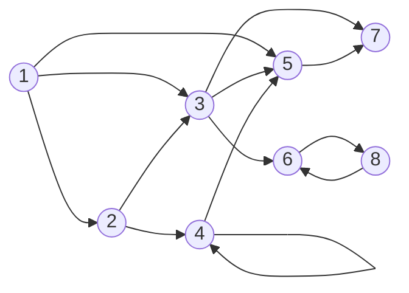
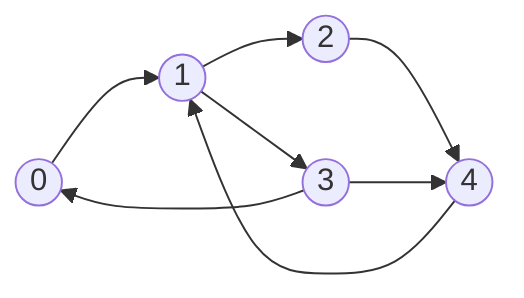
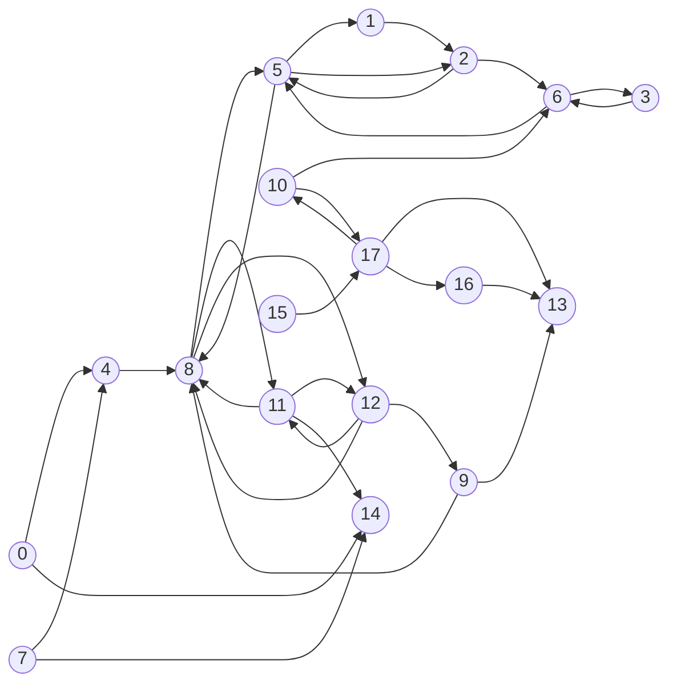

# Atividade 8 — Estrutura de Dados II

**Aluno:** Pedro Rossetto

## Questão 1 — Conceitos de grafos

 Em relação aos conceitos de grafo, explique o que é cada elemento listado abaixo: vértice, aresta, laço, arestas paralelas, vértices adjacentes e quando um caminho é chamado de ciclo.

**Resposta:**

1. **Vértice:** nó ou elemento do conjunto de vértices de um grafo.
2. **Aresta:** ligação entre dois vértices. Em um dígrafo, possui origem e destino definidos.
3. **Laço:** aresta que liga um vértice a ele mesmo, por exemplo, `(4, 4)`.
4. **Arestas paralelas:** duas ou mais arestas distintas que ligam os mesmos vértices (com a mesma orientação, quando dirigidas).
5. **Vértices adjacentes:** vértices unidos diretamente por uma aresta. Em dígrafos, a orientação importa.
6. **Ciclo:** caminho fechado que começa e termina no mesmo vértice; em um ciclo simples, nenhum outro vértice é repetido.

## Questão 2 — Representações de dígrafos

### Questão 2.1 — Matriz de adjacência

 Analise o primeiro dígrafo e apresente sua matriz de adjacência, preservando a direção das setas e o laço.

**Resposta:**

| Origem / Destino | 1 | 2 | 3 | 4 | 5 | 6 |
| --- | --- | --- | --- | --- | --- | --- |
| 1 | 0 | 1 | 0 | 0 | 0 | 0 |
| 2 | 0 | 1 | 0 | 1 | 1 | 0 |
| 3 | 0 | 0 | 0 | 0 | 0 | 0 |
| 4 | 1 | 0 | 0 | 0 | 1 | 0 |
| 5 | 0 | 0 | 0 | 1 | 0 | 0 |
| 6 | 0 | 0 | 1 | 0 | 0 | 0 |

Arestas: `1 → 2`, `2 → 2`, `2 → 4`, `2 → 5`, `4 → 1`, `4 → 5`, `5 → 4` e `6 → 3`.


### 2.2 — Lista de adjacência

 Analise o segundo dígrafo e registre os vértices de destino para cada vértice de origem.

**Resposta:**

| Vértice | Adjacentes (saída) | Grau de saída |
| --- | --- | --- |
| A | B | 1 |
| B | C, D, E | 3 |
| C | E | 1 |
| D | E | 1 |
| E | F | 1 |
| F | ∅ | 0 |
| G | D | 1 |


### 2.3 — Matriz de incidência

 Analise o terceiro dígrafo e construa sua matriz de incidência, com as arestas `a` a `f` nas colunas e os vértices `1` a `4` nas linhas.

**Resposta:**

| Vértice | a | b | c | d | e | f |
| --- | --- | --- | --- | --- | --- | --- |
| 1 | -1 | 1 | 0 | 0 | -1 | 0 |
| 2 | 1 | 0 | 1 | 0 | 0 | 1 |
| 3 | 0 | 0 | 0 | -1 | 1 | -1 |
| 4 | 0 | -1 | -1 | 1 | 0 | 0 |


## Questão 3 — Desenho do dígrafo

 Dados os conjuntos abaixo, desenhe o dígrafo correspondente, incluindo todas as arestas e o laço.

`V = {1, 2, 3, 4, 5, 6, 7, 8}`

`A = {(1,2), (1,5), (1,3), (2,3), (2,4), (3,5), (3,6), (3,7), (4,5), (4,4), (5,7), (6,8), (8,6)}`

**Resposta:**




## Questão 4 — Caminhos e matriz de adjacência

 Considere o vértice inicial `0` e indique possíveis caminhos para alcançar o vértice `4`. Represente também o grafo em uma matriz de adjacência.

**Resposta:**

Representação do grafo:



Matriz de adjacência:

| Origem / Destino | 0 | 1 | 2 | 3 | 4 |
| --- | --- | --- | --- | --- | --- |
| 0 | 0 | 1 | 0 | 0 | 0 |
| 1 | 0 | 0 | 1 | 1 | 0 |
| 2 | 0 | 0 | 0 | 0 | 1 |
| 3 | 1 | 0 | 0 | 0 | 1 |
| 4 | 0 | 1 | 0 | 0 | 0 |


## Questão 5 — Grafo a partir da matriz de adjacência

 Dada a matriz de adjacência de 18 × 18, com vértices numerados de `0` a `17`, desenhe o grafo correspondente.

**Resposta:**




## Questão 6 — Matriz de incidência

 Converta o grafo não direcionado em uma matriz de incidência. As arestas são identificadas pelas letras `a` até `g`.

**Resposta:**

| Vértice | a | b | c | d | e | f | g |
| --- | --- | --- | --- | --- | --- | --- | --- |
| 1 | 1 | 1 | 0 | 0 | 0 | 0 | 0 |
| 2 | 0 | 1 | 1 | 0 | 0 | 1 | 0 |
| 3 | 0 | 0 | 1 | 1 | 0 | 0 | 0 |
| 4 | 0 | 0 | 0 | 1 | 1 | 0 | 1 |
| 5 | 1 | 0 | 0 | 0 | 0 | 1 | 1 |
| 6 | 0 | 0 | 0 | 0 | 1 | 0 | 0 |


## Questão 7 — Programa de manipulação de grafos

 Implemente um programa que manipule um grafo por matriz de adjacência, com no máximo 20 vértices e com o seguinte menu:


**Resposta:** 

```cpp
#include <iostream>
using namespace std;

const int MAX_VERTICES = 20;

int lerInteiro(int minimo, int maximo) {
    int valor;
    while (true) {
        if (cin >> valor && valor >= minimo && valor <= maximo) {
            return valor;
        }
        cout << "Entrada invalida. Digite um numero entre "
             << minimo << " e " << maximo << ": ";
        cin.clear();
        cin.ignore(10000, '\n');
    }
}

int main() {
    int matriz[MAX_VERTICES][MAX_VERTICES] = {};
    int n, opcao, inicio, fim, vertice;
    int quantidadeArestas = 0;

    cout << "Quantidade de vertices (1 a 20): ";
    n = lerInteiro(1, MAX_VERTICES);

    do {
        cout << "\n0 - Sair\n"
             << "1 - Incluir aresta\n"
             << "2 - Mostrar matriz de adjacencia\n"
             << "3 - Remover aresta\n"
             << "4 - Mostrar vertices adjacentes\n"
             << "5 - Mostrar grau de um vertice\n"
             << "Opcao: ";
        opcao = lerInteiro(0, 5);

        if (opcao >= 2 && quantidadeArestas == 0) {
            cout << "Insira pelo menos uma aresta primeiro.\n";
            continue;
        }

        switch (opcao) {
            case 0:
                cout << "Programa encerrado.\n";
                break;

            case 1:
                cout << "Vertice inicial (0 a " << n - 1 << "): ";
                inicio = lerInteiro(0, n - 1);
                cout << "Vertice final (0 a " << n - 1 << "): ";
                fim = lerInteiro(0, n - 1);
                if (matriz[inicio][fim] == 0) {
                    matriz[inicio][fim] = 1;
                    quantidadeArestas++;
                    cout << "Aresta incluida.\n";
                } else {
                    cout << "Aresta ja existente.\n";
                }
                break;

            case 2:
                cout << "\nMatriz de adjacencia:\n   ";
                for (int j = 0; j < n; j++) cout << j << " ";
                cout << "\n";
                for (int i = 0; i < n; i++) {
                    cout << i << ": ";
                    for (int j = 0; j < n; j++) {
                        cout << matriz[i][j] << " ";
                    }
                    cout << "\n";
                }
                break;

            case 3:
                cout << "Vertice inicial (0 a " << n - 1 << "): ";
                inicio = lerInteiro(0, n - 1);
                cout << "Vertice final (0 a " << n - 1 << "): ";
                fim = lerInteiro(0, n - 1);
                if (matriz[inicio][fim] == 1) {
                    matriz[inicio][fim] = 0;
                    quantidadeArestas--;
                    cout << "Aresta removida.\n";
                } else {
                    cout << "Aresta inexistente.\n";
                }
                break;

            case 4: {
                cout << "Vertice (0 a " << n - 1 << "): ";
                vertice = lerInteiro(0, n - 1);
                cout << "Adjacentes de " << vertice << ": ";
                bool encontrou = false;
                for (int j = 0; j < n; j++) {
                    if (matriz[vertice][j] == 1) {
                        cout << j << " ";
                        encontrou = true;
                    }
                }
                if (!encontrou) cout << "nenhum";
                cout << "\n";
                break;
            }

            case 5: {
                cout << "Vertice (0 a " << n - 1 << "): ";
                vertice = lerInteiro(0, n - 1);
                int entrada = 0, saida = 0;
                for (int j = 0; j < n; j++) {
                    saida += matriz[vertice][j];
                    entrada += matriz[j][vertice];
                }
                cout << "Grau de entrada: " << entrada << "\n";
                cout << "Grau de saida: " << saida << "\n";
                cout << "Grau total: " << entrada + saida << "\n";
                break;
            }
        }
    } while (opcao != 0);

    return 0;
}
```
